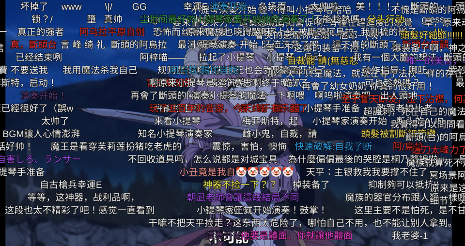
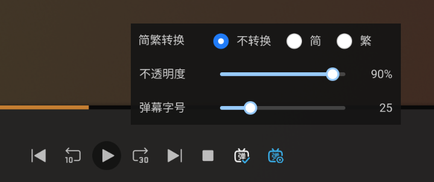

# Plex 弹幕

网页客户端的弹幕插件，支持 Plex 4.116

[ViolentMonkey](https://violentmonkey.github.io) 或者 [TamperMonkey](https://www.tampermonkey.net) 加载 [dist/danmu.user.js](dist/danmu.user.js)

## Demo



### 设置栏



## Alternatives

[lsl330/plex-danmaku](https://github.com/lsl330/plex-danmaku)

[Mr-Quin/danmaku-anywhere](https://github.com/Mr-Quin/danmaku-anywhere)

## Useful Links

[AutoBangumi](https://www.autobangumi.org)

[弹弹Play API](https://api.dandanplay.net/swagger/ui/index)

[Plex命名规范](https://support.plex.tv/articles/naming-and-organizing-your-tv-show-files)

[weizhenye/Danmaku](https://github.com/weizhenye/Danmaku)

## Development

Install Bun and a Node.js version supported by ESLint 10 (for example, Node 24).

```sh
bun install --frozen-lockfile
bun run typecheck
bun run lint:check
bun test
```

`bun run lint` applies lint fixes; `bun run prettier` formats `src/`.
Tests use mocked Dandanplay requests and Happy DOM; they do not need API keys or
a running Plex server.

The application is organized around two hooks: `usePlexPlayer` tracks the current
player DOM and title, and `useComments` loads comments while cancelling stale
requests. API validation lives in `dandanplay.ts`, title parsing in `title.ts`,
and comment conversion in `comments.ts`. Components own the menu and overlay
elements they attach to Plex.

## Local build

Keep `key.sh` in the repository root (it is ignored by Git). It supplies `APP_ID`
and `APP_SECRET` as JavaScript declaration strings, which `build.sh` substitutes
for the placeholder declarations in `src/dandanplay.ts`.

```sh
bash -e build.sh
```

This generates `dist/danmu.user.js` with the shared credentials embedded, then
restores the original source. If the build fails, restore `src/dandanplay.ts`
from the temporary root-level `dandanplay.ts` backup. For a release, increment
`@version` in `src/meta.ts` before building and install the generated userscript
in Tampermonkey or Violentmonkey.
